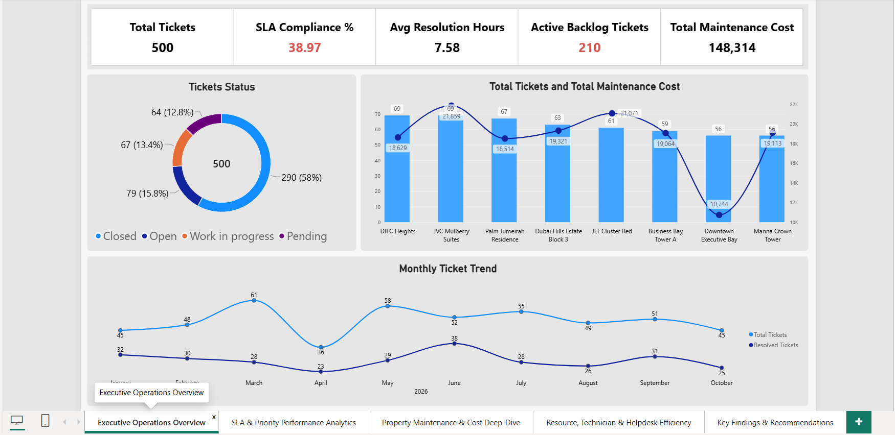
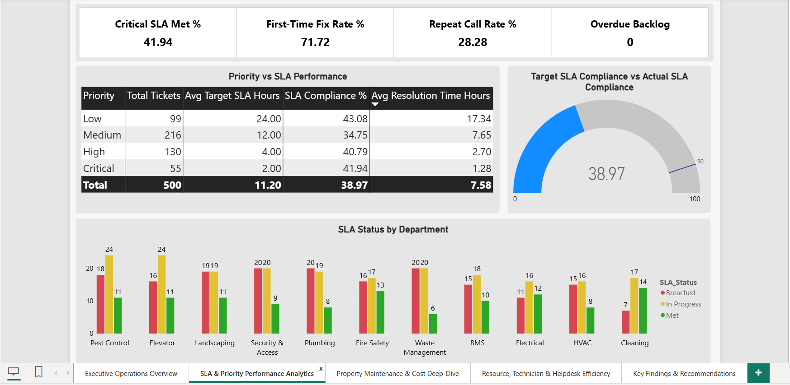
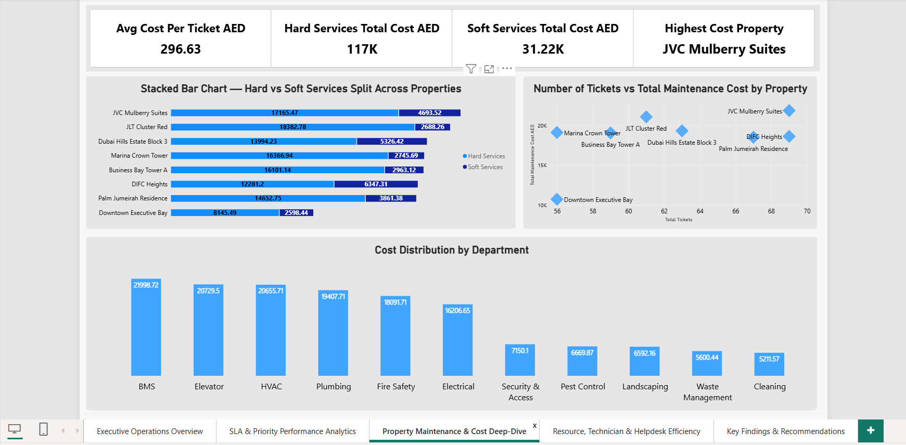
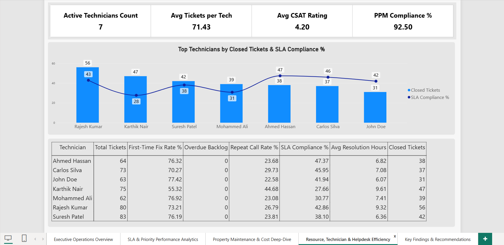
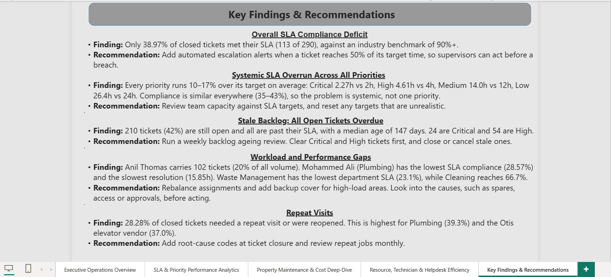

# 🏢 Enterprise CAFM Analytics Dashboard (Power BI)

> **Domain:** Facilities Management (FM) · Computer-Aided Facility Management (CAFM)
> **Tool:** Microsoft Power BI Desktop · **Data:** simulated (see [Data](#-data))
> **Author:** Inamul Hasan

A 5-page Power BI dashboard that turns helpdesk ticket data into operational decisions for a Dubai property portfolio: SLA compliance, backlog ageing, maintenance cost, technician workload and PPM compliance.

It extends my [CAFM Helpdesk Operations project](https://github.com/inamulhasan-stack/CAFM-Helpdesk-Operations), where I ran the ticket lifecycle in Jira Service Management.

---

## 📊 Dashboard pages

| # | Page | What it answers |
|---|------|-----------------|
| 1 | Executive Operations Overview | How many tickets, how many are open, what do they cost? |
| 2 | SLA & Priority Performance | Are we meeting SLAs, and where are we failing? |
| 3 | Property Maintenance & Cost Deep-Dive | Which properties and departments drive cost? |
| 4 | Resource, Technician & Helpdesk Efficiency | Is workload balanced? How are quality and PPM? |
| 5 | Key Findings & Recommendations | What should management do? |

Screenshots: 






---

## 🗂️ Data

**The data is simulated.** It was built to mirror a real FM helpdesk export and contains no real client information.

| File | Rows | Description |
|------|------|-------------|
| `CAFM_Master_Enterprise_Dataset_500_v2.csv` | 500 | Tickets, Jan–Oct 2026, 8 Dubai properties, 11 departments (Hard and Soft services) |
| `CAFM_PPM_Schedule_40.csv` | 40 | Planned preventive maintenance tasks and completion dates |

The Jira project in the linked repository holds 20 hand-created tickets that show the workflow. The 500-row dataset is the analytics layer.

**Report date:** 24 Oct 2026. Backlog age and overdue status are measured against this date.

### Data dictionary (main columns)

| Column | Meaning |
|--------|---------|
| Ticket_ID, Property_Name, Department, Service_Category | Ticket and location. Service_Category is Hard or Soft |
| Priority, Target_SLA_Hours | Critical 2h · High 4h · Medium 12h · Low 24h |
| Status | Open, Work in progress, Pending, Closed |
| Created_Timestamp, Resolved_Timestamp, Actual_Resolution_Hours | Resolved fields are blank for open tickets |
| SLA_Status | Met or Breached (closed tickets); In Progress (open tickets) |
| SLA_Status_Live | As above, but open tickets past target show Overdue |
| Is_Overdue, Backlog_Age_Days | Open tickets only. Overdue means age is greater than the SLA target |
| Assigned_Technician, Technician_Trade, Resource_Type | Technician mapped to department. Resource_Type is In-house or Vendor |
| Visit_Count, Reopened | Closed tickets only. Used for First-Time Fix |
| CSAT_Score | 1–5, available for 200 of 290 closed tickets |
| Maintenance_Cost_AED | Cost on closed tickets; open tickets show 0 |

---

## 🧮 Key DAX measures

```DAX
Total Tickets            = COUNTROWS ( CAFM )
Closed Tickets           = CALCULATE ( COUNTROWS ( CAFM ), CAFM[Status] = "Closed" )
Active Backlog           = CALCULATE ( COUNTROWS ( CAFM ), CAFM[Status] <> "Closed" )

SLA Compliance % (Closed) =
    DIVIDE ( CALCULATE ( COUNTROWS ( CAFM ), CAFM[SLA_Status] = "Met" ), [Closed Tickets] )

Avg Resolution Hours     = AVERAGE ( CAFM[Actual_Resolution_Hours] )   -- closed tickets only

Overdue Backlog          = CALCULATE ( COUNTROWS ( CAFM ), CAFM[Is_Overdue] = "Yes" )
Median Backlog Age (Days)= MEDIAN ( CAFM[Backlog_Age_Days] )

First-Time Fix %         =
    DIVIDE (
        CALCULATE ( COUNTROWS ( CAFM ), CAFM[Status] = "Closed", CAFM[Visit_Count] = 1, CAFM[Reopened] = "No" ),
        [Closed Tickets]
    )
Repeat Call Rate %       = 1 - [First-Time Fix %]

Avg CSAT                 = AVERAGE ( CAFM[CSAT_Score] )
PPM Compliance %         =
    DIVIDE ( CALCULATE ( COUNTROWS ( PPM ), PPM[Completed_On_Time] = "Yes" ), COUNTROWS ( PPM ) )
Avg Cost per Ticket      = DIVIDE ( SUM ( CAFM[Maintenance_Cost_AED] ), [Total Tickets] )
```

**Definitions that matter**
- SLA compliance is calculated on **closed tickets** (113 of 290). Counting open tickets as failures gives 22.6%.
- Average resolution time uses closed tickets only, because open tickets have no resolution time.

---

## 🔍 Key findings & recommendations

| # | Finding | Recommendation |
|---|---------|----------------|
| 1 | **SLA deficit:** 38.97% of closed tickets met SLA, against a 90% target. | Add automated escalation alerts when a ticket reaches 50% of its target time. |
| 2 | **Every priority overruns its target by 10–17% on average** (Critical 2.27h vs 2h; High 4.61h vs 4h; Medium 14.0h vs 12h; Low 26.4h vs 24h). Compliance is 35–43% across all priorities. The problem is systemic, not specific to one priority. | Review capacity against SLA targets, or reset targets to what is achievable. |
| 3 | **Stale backlog:** 210 tickets (42%) are open, all already past SLA, with a median age of 147 days, including 24 Critical and 54 High. | Run a weekly backlog ageing review. Close or cancel stale tickets. Clear Critical and High first. |
| 4 | **Uneven performance:** one supervisor carries 102 tickets (20% of volume). The Plumbing technician has the lowest SLA (28.6%) and the slowest resolution (15.9h). Waste Management has the lowest department SLA (23.1%) against Cleaning at 66.7%. | Rebalance assignments and add backup cover. Investigate causes such as spares, access or approvals before acting. |
| 5 | **Repeat visits:** 28.3% of closed tickets needed more than one visit or were reopened. | Add root-cause codes at closure and review repeat jobs monthly. |

---

## ⚠️ Limitations

- The data is simulated, so the findings show the analysis method, not real operational performance.
- Causes in the recommendations are hypotheses to investigate, not conclusions.
- Sample sizes are small in places (for example, 31 closed Critical tickets).
- Cost is recorded on closed tickets only.

---

## 🚀 How to use

1. Download the two CSV files and `CAFM_Dashboard_Structure.pbix`.
2. Open the `.pbix` in Power BI Desktop and point the data sources to your local CSV paths.
3. Refresh.

## 🛠️ Skills demonstrated

Power BI (data modelling, DAX, slicers) · SLA and KPI design · Helpdesk and CAFM operations · Backlog and workload analysis · Data storytelling
